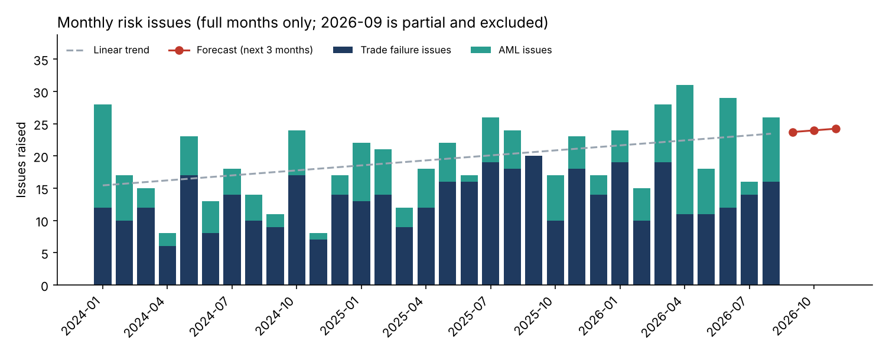
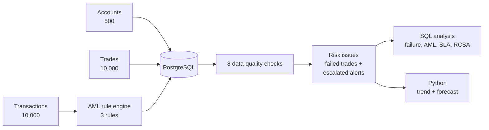
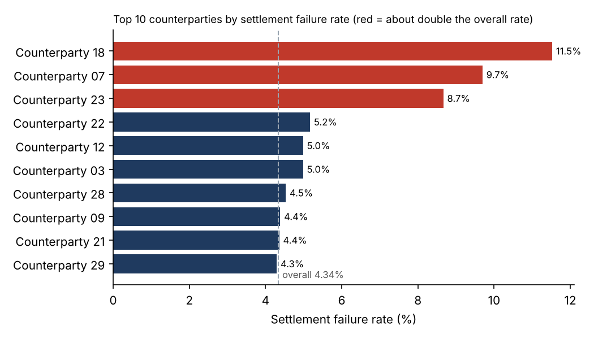
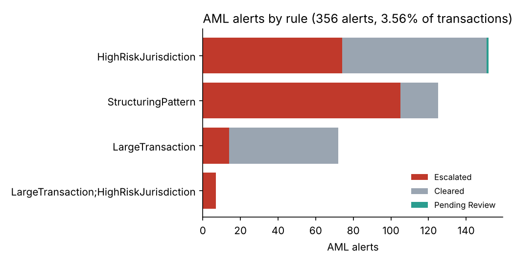

# SentinelIQ: Trade Operations & AML Risk Analytics

One risk view across **trade settlement operations** and **AML transaction monitoring**: 500 accounts, 10,000 trades and 10,000 transactions, analysed with **PostgreSQL** and **Python**. Data-quality checks run first, AML alerts come from documented rules, and every escalated alert or failed trade becomes a tracked risk issue with a severity, an owner category and an SLA.

> **All data is synthetic**, created by [`src/generate_data.py`](src/generate_data.py) (seeded, so it is fully reproducible). Clients, counterparties and amounts are invented. A few data-quality problems were planted on purpose to test the checks.



## How it works



## Key findings (business date 15 Sep 2026)

| Area | Finding |
| --- | --- |
| Settlement | **4.34%** of trades failed; 10.18% of settled trades were late (2.79 business days on average). |
| Counterparties | Counterparties 18, 07 and 23 fail **8.7%–11.5%** of the time, about double the overall rate or more. |
| Failure causes | **SSI mismatch** is the top cause (30.9% of failures), a data problem that better static data could prevent. |
| AML alerts | **356 alerts (3.56%** of transactions); 56.3% of reviewed alerts were escalated. |
| Rule quality | Structuring alerts are escalated **84%** of the time, large-transaction alerts only **19.4%**: the large-value rule creates the most noise. |
| Cross-domain | **54 accounts** have both a failed-trade issue and an escalated AML issue. |
| SLA | **69.6%** of closed issues were resolved by their due date; 15 issues are still open, 3 of them past due. |
| Regions | LATAM has the most issues per account (172.9 per 100 accounts vs 107.3 in APAC). |
| RCSA | AML & Transaction Monitoring moved to **High** risk in 2026-Q2: control effectiveness fell 9.5 points to 67.7%, matching a jump to 44 AML issues that quarter (about 15 per quarter before). |

| Settlement failures by counterparty | AML alerts by rule and outcome |
| --- | --- |
|  |  |

## AML rules

Defined once in [`src/config.py`](src/config.py) and applied by [`src/aml_rules.py`](src/aml_rules.py). The analysis re-runs the rules on the raw data and confirms every flag matches (0 mismatches).

| Rule | Logic |
| --- | --- |
| LargeTransaction | Any transaction of 1,000,000 or more |
| HighRiskJurisdiction | Wire transfer of 100,000 or more to a jurisdiction on the project's high-risk list (illustrative list, not an official one) |
| StructuringPattern | 3 or more cash deposits by the same account, each between 9,000 and 9,999.99 (just under the 10,000 reporting threshold), within 7 days |

## Data-quality checks

[`sql/03_data_quality_checks.sql`](sql/03_data_quality_checks.sql) runs 8 checks before any analysis:

| Check | Exceptions found |
| --- | --- |
| Trade booked before the account was opened | 15 |
| Transaction before the account was opened | 10 |
| Duplicate transaction (same account, time, type, amount) | 8 |
| Trade marked Settled but no settlement date | 5 |
| Flag and flag reason disagree | 0 |
| Issue status and resolution date disagree | 0 |
| Issue resolved before it was raised | 0 |
| Issue points to a trade/transaction that does not exist | 0 |

The four non-zero checks match exactly the problems planted by the generator.

**NULL vs 0:** `DelayDays` is **0** for a trade that settled on time and **NULL** for a trade that has not settled (failed or pending). They mean different things and are kept separate.

## Forecast

September 2026 is a **partial month** (data runs to the 15th, only 12 issues so far), so it is excluded from the trend.

- 32 full months, average **19.4 issues per month**, trend **+0.26 issues per month**.
- **Back-test:** fitted without Jun–Aug 2026, then predicted them. Mean absolute error **5.34 issues/month**, better than simply using the historical average (6.67).
- **Forecast:** about **24 issues per month** for Sep–Nov 2026.

A simple linear trend is used on purpose: it is easy to explain in a risk report. Monthly volumes swing a lot (8 to 31), so the forecast is a planning range, not a precise number.

All numbers above are produced by the code and saved in [`outputs/summary.json`](outputs/summary.json) and [`outputs/sql_results.txt`](outputs/sql_results.txt).

## Repository structure

| Folder | What is inside |
| --- | --- |
| [`data/`](data) | accounts, trades, transactions, risk_issues, rcsa (CSV) |
| [`sql/`](sql) | `01_schema`, `02_load`, `03_data_quality_checks`, `04_analysis` (10 queries) |
| [`src/`](src) | `config.py` (all rules), `aml_rules.py`, `generate_data.py`, `analysis.py` |
| [`tests/`](tests) | 9 tests: AML rules (thresholds, structuring window) and data integrity |
| [`outputs/`](outputs) | charts, `summary.json`, `sql_results.txt` |
| [`docs/`](docs) | data dictionary, Power BI build guide |

## How to run

```bash
pip install -r requirements.txt
python src/generate_data.py      # recreate data/ (optional: files are already included)
python src/analysis.py           # charts + outputs/summary.json
python -m pytest -q              # 9 tests

createdb sentineliq
psql -d sentineliq -f sql/01_schema.sql -f sql/02_load.sql
psql -d sentineliq -f sql/03_data_quality_checks.sql -f sql/04_analysis.sql
```

In pgAdmin, use Import/Export Data for the CSV files instead of `02_load.sql` (steps are in that file).

## SQL techniques used

`COUNT(*) FILTER (WHERE …)` for conditional counts, `HAVING` with two conditions for cross-domain accounts, window functions (`MIN() OVER`, `LAG`, `ROW_NUMBER`, `SUM() OVER`), `UNION ALL` to stack data-quality checks, `LEFT JOIN … IS NULL` to find missing sources, `NULLIF` to avoid division by zero, and indexes on join and filter columns.

## Next step: Power BI dashboard

A dashboard on these tables is planned, not yet built. The model, DAX measures and pages are described in [`docs/POWER_BI_GUIDE.md`](docs/POWER_BI_GUIDE.md).

## Limitations

- Synthetic data: patterns were designed into the generator (for example, three counterparties with higher failure rates), so the analysis shows the method, not real market behaviour.
- The high-risk jurisdiction list is illustrative only.
- A linear trend ignores seasonality; with more history, a seasonal model could be tested against the same back-test.

---
Author: **Salil Gokhale** · [LinkedIn](https://www.linkedin.com/in/salil-gokhale-analytics)
